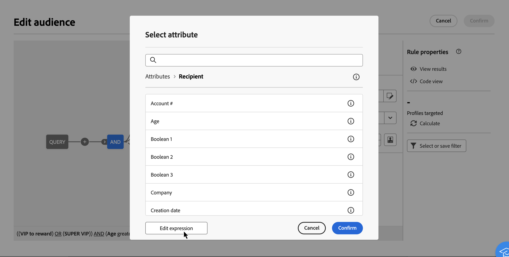
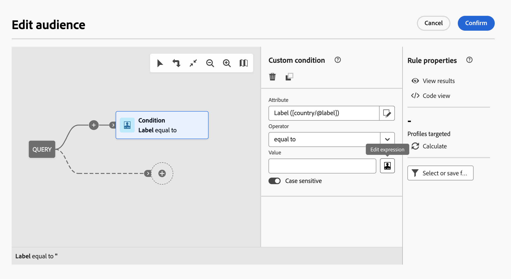
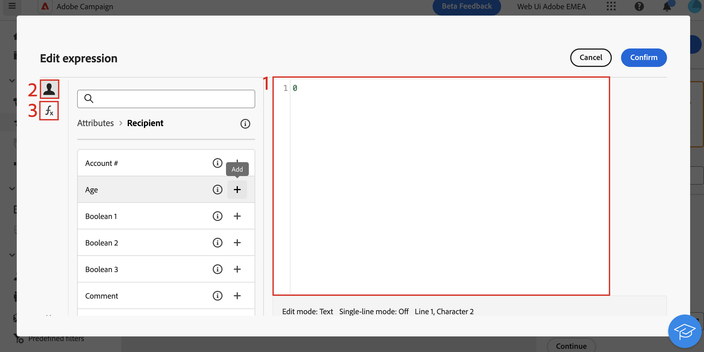
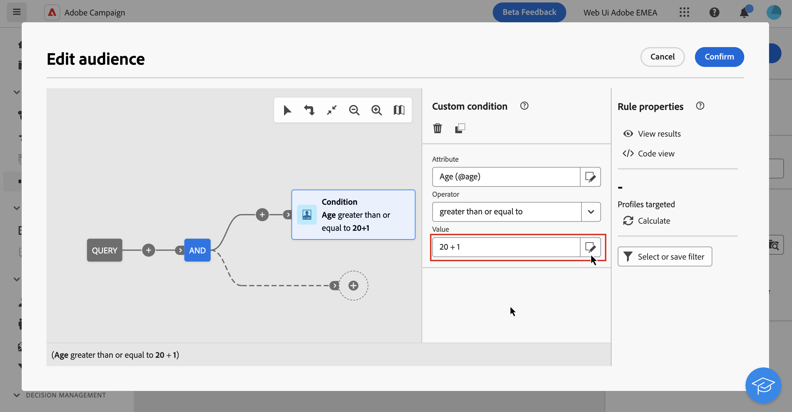

# 運算式編輯器概觀 {#expression}

編輯運算式需要手動輸入條件以形成規則。 此模式可讓您使用進階函式，這些函式可讓您控制用於執行特定查詢的值，例如控制日期、字串、數值欄位、排序等。

## 使用運算式編輯器 {#edit}

設定自訂條件時，**[!UICONTROL 屬性]**&#x200B;和&#x200B;**[!UICONTROL 值]**&#x200B;欄位可使用查詢模型器&#x200B;**[!UICONTROL 編輯運算式]**&#x200B;按鈕中的運算式編輯器。

| 從「**[!UICONTROL 屬性]**」欄位存取 | 從「**[!UICONTROL 值]**」欄位存取 |
|  ---  |  ---  |
| {zoomable="yes"}{width="200" align="center" zoomable="yes"} | {zoomable="yes"}{width="200" align="center" zoomable="yes"} |

運算式編輯器提供：

* 定義運算式的&#x200B;**輸入欄位(1)**。
* 可用的&#x200B;**欄位(2)**&#x200B;清單，可用於運算式中，並與查詢的結構描述（也稱為目標維度）相對應。
* **協助程式函式 (3)**，依類別排序。

直接在輸入欄位中輸入運算式以編輯運算式。 若要新增欄位或協助程式函式，請將游標置於要新增的運算式中，然後選取+按鈕。

{zoomable="yes"}

當運算式準備就緒時，請選取&#x200B;**[!UICONTROL 確認]**。 運算式會顯示在選取的欄位中。 若要編輯，請開啟運算式編輯器並進行所需的變更。

下列範例顯示為&#x200B;**[!UICONTROL 值]**&#x200B;欄位設定的運算式。 若要編輯它，您必須使用&#x200B;**[!UICONTROL 編輯運算式]**&#x200B;按鈕開啟運算式編輯器。

{zoomable="yes"}

## 協助程式功能

查詢編輯工具可讓您使用進階功能，根據所需結果和操作資料的類型執行複雜的篩選。 可使用下列函式：

### 日期

日期函式可用來處理日期或時間值。

>[!BEGINTABS]

>[!TAB Google BigQuery]

| 名稱 | 說明 | 語法 | 範例 |
| ---- | ----------- | ------ | ------- |
| **AddYears** | 將指定的年數新增到提供的日期時間。 | AddYears(&lt;DATETIME>， &lt;NUMBER>) | AddYears(&quot;2019-12-25 15:30:00&quot;， 3) |
| **AddMonths** | 將指定的月數新增到提供的日期時間。 | AddMonths(&lt;DATETIME>， &lt;NUMBER>) | AddMonths(&quot;2019-12-25 15:30:00&quot;， 6) |
| **AddDays** | 將指定的天數新增至提供的日期時間。 | AddDays(&lt;DATETIME>， &lt;NUMBER>) | AddDays(&quot;2019-12-25 15:30:00&quot;， 10) |
| **AddHours** | 將指定的小時數新增到提供的日期時間。 | AddHours(&lt;DATETIME>， &lt;NUMBER>) | AddHours(&quot;2019-12-25 15:30:00&quot;， 3) |
| **AddMinutes** | 將指定的分鐘數新增到提供的日期時間。 | AddMinutes(&lt;DATETIME>， &lt;NUMBER>) | AddMinutes(&quot;2019-12-25 15:30:00&quot;， 32) |
| **AddSeconds** | 將指定的秒數新增到提供的日期時間。 | AddSeconds(&lt;DATETIME>， &lt;NUMBER>) | AddSeconds(&quot;2019-12-25 15:30:00&quot;， 37) |
| **SubYears** | 將指定的年數減去提供的日期時間。 | SubYears(&lt;DATETIME>， &lt;NUMBER>) | SubYears(&quot;2019-12-25 15:30:00&quot;， 3) |
| **SubMonths** | 將指定的月數減去提供的日期時間。 | SubMonths(&lt;DATETIME>， &lt;NUMBER>) | SubMonths(&quot;2019-12-25 15:30:00&quot;， 6) |
| **SubDays** | 將指定的天數減去提供的日期時間。 | SubDays(&lt;DATETIME>， &lt;NUMBER>) | SubDays(&quot;2019-12-25 15:30:00&quot;， 10) |
| **SubHours** | 將指定的小時數減去提供的日期時間。 | SubHours(&lt;DATETIME>， &lt;NUMBER>) | SubHours(&quot;2019-12-25 15:30:00&quot;， 3) |
| **SubMinutes** | 將指定的分鐘數減去提供的日期時間。 | SubMinutes(&lt;DATETIME>， &lt;NUMBER>) | SubMinutes(&quot;2019-12-25 15:30:00&quot;， 32) |
| **SubSeconds** | 將指定的秒數減去提供的日期時間。 | SubSeconds(&lt;DATETIME>， &lt;NUMBER>) | SubSeconds(&quot;2019-12-25 15:30:00&quot;， 37) |
| **年** | 從指定的datetime物件中擷取年份。 | Year(&lt;DATETIME>) | 年(&quot;2019-12-15 15:30:00&quot;) |
| **Month** | 從指定的datetime物件中擷取月份。 | Month(&lt;DATETIME>) | 月份(&quot;2019-12-15 15:30:00&quot;) |
| **Day** | 從指定的datetime物件中擷取日。 | Day(&lt;DATETIME>) | Day(&quot;2019-12-15 15:30:00&quot;) |
| **DayOfYear** | 從指定的datetime物件中擷取一年中的第幾天。 例如，如果提供的日期時間是2月2日，則會傳回33。 | DayOfYear(&lt;DATETIME>) | DayOfYear(&quot;2019-12-15 15:30:00&quot;) |
| **WeekDay** | 從指定的datetime物件中擷取一週中的某天，數值從0到6,0代表星期日。 | Year(&lt;DATETIME>) | 年(&quot;2019-12-15 15:30:00&quot;) |
| **Hour** | 從指定的datetime物件中擷取小時值。 | Year(&lt;DATETIME>) | 年(&quot;2019-12-15 15:30:00&quot;) |
| **Minute** | 從指定的datetime物件中擷取分鐘值。 | Year(&lt;DATETIME>) | 年(&quot;2019-12-15 15:30:00&quot;) |
| **Second** | 從指定的datetime物件中擷取第二個值。 | Year(&lt;DATETIME>) | 年(&quot;2019-12-15 15:30:00&quot;) |
| **YearsDiff** | 找出指定日期時間之間的差異，並以年為粒度。 | YearsDiff(&lt;DATETIME>， &lt;DATETIME>) | YearsDiff(&quot;2019-12-25 15:30:00&quot;， &quot;2018-10-14 18:35:27&quot;) |
| **MonthsDiff** | 尋找指定日期時間之間的差異，其粒度為月。 | MonthsDiff(&lt;DATETIME>， &lt;DATETIME>) | MonthsDiff(&quot;2019-12-25 15:30:00&quot;， &quot;2018-10-14 18:35:27&quot;) |
| **DaysDiff** | 找出指定日期時間之間的差異，並以天為粒度。 | DaysDiff(&lt;DATETIME>， &lt;DATETIME>) | DaysDiff(&quot;2019-12-25 15:30:00&quot;， &quot;2018-10-14 18:35:27&quot;) |
| **HoursDiff** | 尋找指定日期時間之間的差異，其詳細程度為小時。 | HoursDiff(&lt;DATETIME>， &lt;DATETIME>) | HoursDiff(&quot;2019-12-25 15:30:00&quot;， &quot;2018-10-14 18:35:27&quot;) |
| **MinutesDiff** | 尋找指定日期時間之間的差異，其詳細程度為分鐘。 | MinutesDiff(&lt;DATETIME>， &lt;DATETIME>) | MinutesDiff(&quot;2019-12-25 15:30:00&quot;， &quot;2018-10-14 18:35:27&quot;) |
| **SecondsDiff** | 尋找指定日期時間之間的差異，其詳細程度為秒。 | SecondsDiff(&lt;DATETIME>， &lt;DATETIME>) | SecondsDiff(&quot;2019-12-25 15:30:00&quot;， &quot;2018-10-14 18:35:27&quot;) |
| **YearsOld** | 找出指定日期時間與目前時間之間的差異，並以年為粒度。 | YearsOld(&lt;DATETIME>) | YearsOld(&quot;2019-12-25 15:30:00&quot;) |
| **MonthsOld** | 找出指定日期時間與目前時間之間的差異，粒度為月。 | MonthsOld(&lt;DATETIME>) | MonthsOld(&quot;2019-12-25 15:30:00&quot;) |
| **DaysOld** | 找出指定日期時間與目前時間之間的差異，並以天為粒度。 | DaysOld(&lt;DATETIME>) | DaysOld(&quot;2019-12-25 15:30:00&quot;) |
| **GetDate** | 取得伺服器的目前日期。 | GetDate() | GetDate() |
| **DateOnly** | 將日期時間截斷為只有年、月和日。 | DateOnly(&lt;DATETIME>) | DateOnly(&quot;2019-12-25 15:30:00&quot;) |
| **ToDate** | 將欄位轉換為日期欄位。 | ToDate(&lt;DATETIME>) | ToDate(&quot;2019-12-25 15:30:00&quot;) |
| **ToDateTime** | 將欄位轉換為日期時間欄位。 | ToDateTime(&lt;DATE>) | ToDateTime(&quot;2019-12-25 15:30:00&quot;) |
| **ToTimestamp** | 將欄位轉換為時間戳記欄位。 | ToTimestamp(&lt;DATETIME>) | ToTimestamp(&quot;2019-12-25 15:30:00&quot;) |
| **Oldest** | 傳回提供的兩個日期之間的最早日期。 | Oldest(&lt;DATETIME>， &lt;DATETIME>) | Oldest(&quot;2015-02-13 11:59:59&quot;， &quot;2016-04-13 19:28:14&quot;) |
| **TruncDate** | 根據指定的數值，將日期時間截斷為最接近的單位。 如果數值等於60，則會截斷至最接近的分鐘。 如果數值等於3600，則會截斷為最接近的小時。 如果數值等於86400，則會截斷至最接近的天數。 否則，會截斷至最接近的秒數。 | TruncDate(&lt;DATETIME>， &lt;NUMBER>) | TruncDate(&quot;2016-04-13 19:28:14&quot;， 3600) |
| **TruncDateTZ** | 根據指定的數值，將日期時間截斷為最接近的單位，並將日期時間設定為指定的時區。 如果數值等於60，則會截斷至最接近的分鐘。 如果數值等於3600，則會截斷為最接近的小時。 如果數值等於86400，則會截斷至最接近的天數。 | TruncDateTZ(&lt;DATETIME>， &lt;NUMBER>， &lt;TIMEZONE>) | TruncDateTZ(&quot;2016-04-13 19:28:14&quot;， 3600， &quot;America/Los_Angeles&quot;) |
| **TruncTime** | 將日期時間設為2000年1月1日，並根據指定的數值將剩餘的日期時間四捨五入至最接近的單位。如果數值等於60，則會截斷至最接近的分鐘。 如果數值等於3600，則會截斷為最接近的小時。 | TruncTime(&lt;DATETIME>， &lt;NUMBER>) | TruncTime(&quot;2016-04-13 19:28:14&quot;， 3600) |
| **TruncQuarter** | 將日期時間截斷為最接近季度中的第一個日期。 | TruncQuarter(&lt;DATETIME>) | TruncQuarter(&quot;2016-04-13 19:28:14&quot;) |
| **TruncYear** | 將日期時間截斷為最接近年份中的第一個日期。 | TruncYear(&lt;DATETIME>) | TruncYear(&quot;2016-04-13 19:28:14&quot;) |
| **TruncWeek** | 將日期時間截斷為最接近一週的星期日。 | TruncWeek(&lt;DATETIME>) | TruncWeek(&quot;2016-04-13 19:28:14&quot;) |

>[!TAB Snowflake]

| 名稱 | 說明 | 語法 | 範例 |
| ---- | ----------- | ------ | ------- |
| **AddYears** | 將指定的年數新增到提供的日期時間。 | AddYears(&lt;DATETIME>， &lt;NUMBER>) | AddYears(&quot;2019-12-25 15:30:00&quot;， 3) |
| **AddMonths** | 將指定的月數新增到提供的日期時間。 | AddMonths(&lt;DATETIME>， &lt;NUMBER>) | AddMonths(&quot;2019-12-25 15:30:00&quot;， 6) |
| **AddDays** | 將指定的天數新增至提供的日期時間。 | AddDays(&lt;DATETIME>， &lt;NUMBER>) | AddDays(&quot;2019-12-25 15:30:00&quot;， 10) |
| **AddHours** | 將指定的小時數新增到提供的日期時間。 | AddHours(&lt;DATETIME>， &lt;NUMBER>) | AddHours(&quot;2019-12-25 15:30:00&quot;， 3) |
| **AddMinutes** | 將指定的分鐘數新增到提供的日期時間。 | AddMinutes(&lt;DATETIME>， &lt;NUMBER>) | AddMinutes(&quot;2019-12-25 15:30:00&quot;， 32) |
| **AddSeconds** | 將指定的秒數新增到提供的日期時間。 | AddSeconds(&lt;DATETIME>， &lt;NUMBER>) | AddSeconds(&quot;2019-12-25 15:30:00&quot;， 37) |
| **SubYears** | 將指定的年數減去提供的日期時間。 | SubYears(&lt;DATETIME>， &lt;NUMBER>) | SubYears(&quot;2019-12-25 15:30:00&quot;， 3) |
| **SubMonths** | 將指定的月數減去提供的日期時間。 | SubMonths(&lt;DATETIME>， &lt;NUMBER>) | SubMonths(&quot;2019-12-25 15:30:00&quot;， 6) |
| **SubDays** | 將指定的天數減去提供的日期時間。 | SubDays(&lt;DATETIME>， &lt;NUMBER>) | SubDays(&quot;2019-12-25 15:30:00&quot;， 10) |
| **SubHours** | 將指定的小時數減去提供的日期時間。 | SubHours(&lt;DATETIME>， &lt;NUMBER>) | SubHours(&quot;2019-12-25 15:30:00&quot;， 3) |
| **SubMinutes** | 將指定的分鐘數減去提供的日期時間。 | SubMinutes(&lt;DATETIME>， &lt;NUMBER>) | SubMinutes(&quot;2019-12-25 15:30:00&quot;， 32) |
| **SubSeconds** | AdSubtracts會將指定的秒數減去提供的日期時間。 | SubSeconds(&lt;DATETIME>， &lt;NUMBER>) | SubSeconds(&quot;2019-12-25 15:30:00&quot;， 37) |
| **年** | 從指定的datetime物件中擷取年份。 | Year(&lt;DATETIME>) | 年(&quot;2019-12-15 15:30:00&quot;) |
| **Month** | 從指定的datetime物件中擷取月份。 | Month(&lt;DATETIME>) | 月份(&quot;2019-12-15 15:30:00&quot;) |
| **Day** | 從指定的datetime物件中擷取日。 | Day(&lt;DATETIME>) | Day(&quot;2019-12-15 15:30:00&quot;) |
| **DayOfYear** | 從指定的datetime物件中擷取一年中的第幾天。 例如，如果提供的日期時間是2月2日，則會傳回33。 | DayOfYear(&lt;DATETIME>) | DayOfYear(&quot;2019-12-15 15:30:00&quot;) |
| **WeekDay** | 從指定的datetime物件中擷取一週中的某天，數字從1到7,1代表星期日。 | Year(&lt;DATETIME>) | 年(&quot;2019-12-15 15:30:00&quot;) |
| **Hour** | 從指定的datetime物件中擷取小時值。 | Year(&lt;DATETIME>) | 年(&quot;2019-12-15 15:30:00&quot;) |
| **Minute** | 從指定的datetime物件中擷取分鐘值。 | Year(&lt;DATETIME>) | 年(&quot;2019-12-15 15:30:00&quot;) |
| **Second** | 從指定的datetime物件中擷取第二個值。 | Year(&lt;DATETIME>) | 年(&quot;2019-12-15 15:30:00&quot;) |
| **YearsDiff** | 找出指定日期時間之間的差異，並以年為粒度。 | YearsDiff(&lt;DATETIME>， &lt;DATETIME>) | YearsDiff(&quot;2019-12-25 15:30:00&quot;， &quot;2018-10-14 18:35:27&quot;) |
| **MonthsDiff** | 尋找指定日期時間之間的差異，其粒度為月。 | MonthsDiff(&lt;DATETIME>， &lt;DATETIME>) | MonthsDiff(&quot;2019-12-25 15:30:00&quot;， &quot;2018-10-14 18:35:27&quot;) |
| **DaysDiff** | 找出指定日期時間之間的差異，並以天為粒度。 | DaysDiff(&lt;DATETIME>， &lt;DATETIME>) | DaysDiff(&quot;2019-12-25 15:30:00&quot;， &quot;2018-10-14 18:35:27&quot;) |
| **HoursDiff** | 尋找指定日期時間之間的差異，其詳細程度為小時。 | HoursDiff(&lt;DATETIME>， &lt;DATETIME>) | HoursDiff(&quot;2019-12-25 15:30:00&quot;， &quot;2018-10-14 18:35:27&quot;) |
| **MinutesDiff** | 尋找指定日期時間之間的差異，其詳細程度為分鐘。 | MinutesDiff(&lt;DATETIME>， &lt;DATETIME>) | MinutesDiff(&quot;2019-12-25 15:30:00&quot;， &quot;2018-10-14 18:35:27&quot;) |
| **SecondsDiff** | 尋找指定日期時間之間的差異，其詳細程度為秒。 | SecondsDiff(&lt;DATETIME>， &lt;DATETIME>) | SecondsDiff(&quot;2019-12-25 15:30:00&quot;， &quot;2018-10-14 18:35:27&quot;) |
| **MonthsOld** | 找出指定日期時間與目前時間之間的差異，粒度為月。 | MonthsOld(&lt;DATETIME>) | MonthsOld(&quot;2019-12-25 15:30:00&quot;) |
| **DaysOld** | 找出指定日期時間與目前時間之間的差異，並以天為粒度。 | DaysOld(&lt;DATETIME>) | DaysOld(&quot;2019-12-25 15:30:00&quot;) |
| **GetDate** | 取得伺服器的目前日期。 | GetDate() | GetDate() |
| **DateOnly** | 將日期時間截斷為只有年、月和日。 | DateOnly(&lt;DATETIME>) | DateOnly(&quot;2019-12-25 15:30:00&quot;) |
| **ToDate** | 將欄位轉換為日期欄位。 | ToDate(&lt;DATETIME>) | ToDate(&quot;2019-12-25 15:30:00&quot;) |
| **ToDateTime** | 將欄位轉換為日期時間欄位。 | ToDateTime(&lt;DATE>) | ToDateTime(&quot;2019-12-25 15:30:00&quot;) |
| **ToTimestamp** | 將欄位轉換為時間戳記欄位。 | ToTimestamp(&lt;DATETIME>) | ToTimestamp(&quot;2019-12-25 15:30:00&quot;) |
| **Oldest** | 傳回提供的兩個日期之間的最早日期。 | Oldest(&lt;DATETIME>， &lt;DATETIME>) | Oldest(&quot;2015-02-13 11:59:59&quot;， &quot;2016-04-13 19:28:14&quot;) |
| **TruncDate** | 根據指定的數值，將日期時間截斷為最接近的單位。 如果數值等於60，則會截斷至最接近的分鐘。 如果數值等於3600，則會截斷為最接近的小時。 如果數值等於86400，則會截斷至最接近的天數。 否則，會截斷至最接近的秒數。 | TruncDate(&lt;DATETIME>， &lt;NUMBER>) | TruncDate(&quot;2016-04-13 19:28:14&quot;， 3600) |
| **TruncDateTZ** | 根據指定的數值，將日期時間截斷為最接近的單位，並將日期時間設定為指定的時區。 如果數值等於60，則會截斷至最接近的分鐘。 如果數值等於3600，則會截斷為最接近的小時。 如果數值等於86400，則會截斷至最接近的天數。 | TruncDateTZ(&lt;DATETIME>， &lt;NUMBER>， &lt;TIMEZONE>) | TruncDateTZ(&quot;2016-04-13 19:28:14&quot;， 3600， &quot;America/Los_Angeles&quot;) |
| **TruncTime** | 將日期時間設為2000年1月1日，並根據指定的數值將剩餘的日期時間四捨五入至最接近的單位。如果數值等於60，則會截斷至最接近的分鐘。 如果數值等於3600，則會截斷為最接近的小時。 | TruncTime(&lt;DATETIME>， &lt;NUMBER>) | TruncTime(&quot;2016-04-13 19:28:14&quot;， 3600) |
| **TruncQuarter** | 將日期時間截斷為最接近季度中的第一個日期。 | TruncQuarter(&lt;DATETIME>) | TruncQuarter(&quot;2016-04-13 19:28:14&quot;) |
| **TruncYear** | 將日期時間截斷為最接近年份中的第一個日期。 | TruncYear(&lt;DATETIME>) | TruncYear(&quot;2016-04-13 19:28:14&quot;) |
| **TruncWeek** | 將日期時間截斷為最接近一週的星期日。 | TruncWeek(&lt;DATETIME>) | TruncWeek(&quot;2016-04-13 19:28:14&quot;) |
| **ConvertNTZ** | 將沒有時區的時間戳記轉換為具有時區的時間戳記。 附加的時區將是外部帳戶的時區。 | ConvertNTZ(&lt;DATETIME>) | ConvertNTZ(&quot;2024-06-24 14:43:49&quot;) |

>[!ENDTABS]

>[!NOTE]
>
>請注意，**Dateonly**&#x200B;函式會考量伺服器的時區，而非運運算元的時區。

### 地理行銷

地理行銷函式用於操縱地理值。

>[!BEGINTABS]

>[!TAB Google BigQuery]

| 名稱 | 說明 | 語法 | 範例 |
| ---- | ----------- | ------ | ------- |
| **Distance** | 傳回由經度和緯度定義的兩點之間的距離（以度為單位），以雙精度表示。 | Distance(&lt;NUMBER>， &lt;NUMBER>， &lt;NUMBER>， &lt;NUMBER>) | 距離(40.345， 39.2345， -35.5834， 34.599) |

>[!TAB Snowflake]

| 名稱 | 說明 | 語法 | 範例 |
| ---- | ----------- | ------ | ------- |
| **Distance** | 傳回由經度和緯度定義的兩點之間的距離（以度為單位），以雙精度表示。 | Distance(&lt;NUMBER>， &lt;NUMBER>， &lt;NUMBER>， &lt;NUMBER>) | 距離(40.345， 39.2345， -35.5834， 34.599) |

>[!ENDTABS]

### 數值

數值函數可用來將文轉換為數字。

>[!BEGINTABS]

>[!TAB Google BigQuery]

| 名稱 | 說明 | 語法 | 範例 |
| ---- | ----------- | ------ | ------- |
| **Mod** | 傳回第一個數字的餘數除以第二個數字。 | Mod(&lt;NUMBER>， &lt;NUMBER>) | Mod (3， 2) |
| **Percent** | 計算第一個數字佔第二個數字的百分比。 | Percent(&lt;NUMBER>， &lt;NUMBER>) | Percent(1， 2) |
| **Random** | 傳回介於0 （含）和1 （含）之間的隨機數字。 | Random() | 隨機() |
| **Round** | 將提供的數字傳回至要求的最接近的小數位數。 | Round(&lt;NUMBER>， &lt;NUMBER>) | Round(4.5394， 2) |
| **ToDouble** | 將提供的數字轉換為雙精度浮點數。 | ToDouble(&lt;NUMBER>) | ToDouble(5) |
| **ToInteger** | 將提供的數字轉換為整數。 | ToInteger(&lt;NUMBER>) | ToInteger(45) |
| **ToInt64** | 將提供的數字轉換為64位元整數。 | ToInt64(&lt;NUMBER>) | ToInt64(493) |
| **Trunc** | 將提供的數字截斷為請求的小數位數。 | Trunc(&lt;NUMBER>， &lt;NUMBER>) | Trunc(36.9348934， 3) |

>[!TAB Snowflake]

| 名稱 | 說明 | 語法 | 範例 |
| ---- | ----------- | ------ | ------- |
| **Mod** | 傳回第一個數字的餘數除以第二個數字。 | Mod(&lt;NUMBER>， &lt;NUMBER>) | Mod (3， 2) |
| **Percent** | 計算第一個數字佔第二個數字的百分比。 | Percent(&lt;NUMBER>， &lt;NUMBER>) | Percent(1， 2) |
| **Random** | 傳回介於0 （含）和1 （含）之間的隨機數字。 | Random() | 隨機() |
| **ToDouble** | 將提供的數字轉換為雙精度浮點數。 | ToDouble(&lt;NUMBER>) | ToDouble(5) |
| **ToInteger** | 將提供的數字轉換為整數。 | ToInteger(&lt;NUMBER>) | ToInteger(45) |
| **ToInt64** | 將提供的數字轉換為64位元整數。 | ToInt64(&lt;NUMBER>) | ToInt64(493) |
| **Trunc** | 將提供的數字截斷為請求的小數位數。 | Trunc(&lt;NUMBER>， &lt;NUMBER>) | Trunc(36.9348934， 3) |

>[!ENDTABS]

### 其他

此表包含剩餘的可用函式。

>[!BEGINTABS]

>[!TAB Google BigQuery]

| 名稱 | 說明 | 語法 | 範例 |
| ---- | ----------- | ------ | ------- |
| **Case** | 如果運算式為true，則傳回第一個值。 否則，傳回第二個值。 | Case(When（&lt;運算式> &lt;值>）， Else（&lt;值>）) | Case(當(a > b， &quot;yes&quot;)， Else(&quot;no&quot;)) |
| **When** | 用作Case函式的一部分。 用於檢查Case中的運算式。 | When（&lt;運算式> &lt;值>） | 當（a > b，「是」） |
| **Else** | 用作Case函式的一部分。 如果When運算式為false，可用來選擇其他選項。 | Else(&lt;VALUE>) | 否則（「否」） |
| **Coalesce** | 傳回第一個非null值。 | Coalesce(&lt;VALUE>， &lt;VALUE>) | 合併(「」、「string」) |
| **Decode** | 如果值相等，則傳回第一個選項。 如果值不相等，則傳回第二個選項。 | Decode(&lt;VALUE>， &lt;VALUE>， &lt;VALUE>， &lt;VALUE>) | Decode(1， 2， &quot;true&quot;， &quot;false&quot;) |
| **GetEmailDomain** | 從提供的電子郵件地址中擷取網域。 | GetEmailDomain(&lt;STRING>) | GetEmailDomain(&quot;`sample@example.com`&quot;) |
| **Iif** | 若條件為true，則傳回第一個選項，若條件為false，則傳回第二個選項。 | Iif(&lt;CONDITION>， &lt;VALUE>， &lt;VALUE>) | Iif(10 &lt; 20， &quot;true&quot;， &quot;false&quot;) |
| **IsEmptyString** | 如果字串為空，則傳回第一個選項。 否則，傳回第二個選項。 | IsEmptyString( &lt;STRING> ，&lt;VALUE>， &lt;VALUE>) | IsEmptyString(&quot;string&quot;， &quot;yes&quot;， &quot;no&quot;) |
| **NewUUID** | 產生新的唯一UUID。 | NewUUID() | NewUUID() |
| **NoNull** | 如果提供的字串不是空的，則傳回該字串，如果提供的字串是空的，則傳回空字串。 | NoNull(&lt;STRING>) | NoNull（「測試」） |
| **IsBitSet** | 對提供的數字執行位元和(&amp;)。 這可讓您檢查第一個引數內的位元是否設定在第二個引數所提供的位置。 | IsBitSet(&lt;NUMBER>， &lt;NUMBER>) | IsBitSet(5， 3) |
| **ClearBit** | 這可讓您清除第二個引數所提供的位置之第一個引數中的位元。 | ClearBit(&lt;NUMBER>， &lt;NUMBER>) | |
| **SetBit** | 對提供的數字執行位元或(\|)。 這可讓您設定第一個引數內的位元，此位元設定於第二個引數所提供的位置。 | SetBit(&lt;NUMBER>， &lt;NUMBER>) | SetBit(5， 3) |
| **RowId** | 傳回行號。 | RowId() | RowId() |
| **ToBoolean** | 將值轉換為布林值。 | ToBoolean(&lt;VALUE>) | ToBoolean(a=b) |

>[!TAB Snowflake]

| 名稱 | 說明 | 語法 | 範例 |
| ---- | ----------- | ------ | ------- |
| **Case** | 如果運算式為true，則傳回第一個值。 否則，傳回第二個值。 | Case(When（&lt;運算式> &lt;值>）， Else（&lt;值>）) | Case(當(a > b， &quot;yes&quot;)， Else(&quot;no&quot;)) |
| **When** | 用作Case函式的一部分。 用於檢查Case中的運算式。 | When（&lt;運算式> &lt;值>） | 當（a > b，「是」） |
| **Else** | 用作Case函式的一部分。 如果When運算式為false，可用來選擇其他選項。 | Else(&lt;VALUE>) | 否則（「否」） |
| **GetEmailDomain** | 從提供的電子郵件地址中擷取網域。 | GetEmailDomain(&lt;STRING>) | GetEmailDomain(&quot;`sample@example.com`&quot;) |
| **Iif** | 若條件為true，則傳回第一個選項，若條件為false，則傳回第二個選項。 | Iif(&lt;CONDITION>， &lt;VALUE>， &lt;VALUE>) | Iif(10 &lt; 20， &quot;true&quot;， &quot;false&quot;) |
| **IsEmptyString** | 如果字串為空，則傳回第一個選項。 否則，傳回第二個選項。 | IsEmptyString( &lt;STRING> ，&lt;VALUE>， &lt;VALUE>) | IsEmptyString(&quot;string&quot;， &quot;yes&quot;， &quot;no&quot;) |
| **ToBoolean** | 如果值為true，則傳回1。 如果值為false，則傳回0。 | ToBoolean(&lt;VALUE>) | ToBoolean(a=b) |
| **ToBooleanType** | 將值轉換為布林值。 | ToBooleanType(&lt;VALUE>) | ToBooleanType(a=b) |
| **IsBitSet** | 對提供的數字執行位元和(&amp;)。 這可讓您檢查第一個引數內的位元是否設定在第二個引數所提供的位置。 | IsBitSet(&lt;NUMBER>， &lt;NUMBER>) | IsBitSet(5， 3) |
| **ClearBit** | 這可讓您清除第二個引數所提供的位置之第一個引數中的位元。 | ClearBit(&lt;NUMBER>， &lt;NUMBER>) | |
| **SetBit** | 對提供的數字執行位元或(\|)。 這可讓您設定第一個引數內的位元，此位元設定於第二個引數所提供的位置。 | SetBit(&lt;NUMBER>， &lt;NUMBER>) | SetBit(5， 3) |
| **RowId** | 傳回行號。 | RowId() | RowId() |
| **NewUUID** | 產生新的唯一UUID。 | NewUUID() | NewUUID() |
| **NoNull** | 如果提供的字串不是空的，則傳回該字串，如果提供的字串是空的，則傳回空字串。 | NoNull(&lt;STRING>) | NoNull（「測試」） |
| **AESEncrypt** | 使用AES加密型別加密提供的字串。 | AESEncrypt() | AESEncrypt(&quot;hello&quot;) |
| **物件建構** | 根據提供的索引鍵/值組建立物件。 | ObjectConstruct(&lt;STRING>， &lt;STRING>) | ObjectConstruct(&quot;key&quot;， &quot;value&quot;) |

>[!ENDTABS]

### 字串

字串函式可用來控制一組字串。

>[!BEGINTABS]

>[!TAB Google BigQuery]

| 名稱 | 說明 | 語法 | 範例 |
| ---- | ----------- | ------ | ------- |
| **AllNonNull2** | 接受兩個字串並檢查它們是否全部不是Null且不是空白。 | AllNonNull2(&lt;STRING>， &lt;STRING>) | AllNonNull2(&quot;， &quot;string2&quot;) |
| **AllNonNull3** | 接受三個字串並檢查它們是否全部不是Null且不是空白 | AllNonNull3(&lt;STRING>， &lt;STRING>， &lt;STRING>) | AllNonNull3(&quot;， &quot;one&quot;， &quot;three&quot;) |
| **Ascii** | 接受字串並傳回結果。 | Ascii(&lt;STRING>) | Ascii (「foo」) |
| **Char** | 接受一系列Unicode程式碼點並傳回產生的字串。 | Char(&lt;ARRAY>) | 字元([65， 68， 79， 66， 69]) |
| **Charindex** | 尋找指定子字串在主字串中的第一次出現。 | Charindex(&lt;STRING>， &lt;SUBSTRING>) | 字元索引(&quot;bar@example.com&quot;， &quot;@&quot;) |
| **DataLength** | 傳回字串中的位元組數。 | dataLength(&lt;STRING>) | dataLength（「我的字串」） |
| **GetLine** | 傳回所提供字串的請求行。 | GetLine(&lt;STRING>， &lt;NUMBER>) | GetLine(multilinestring， 5) |
| **IfEquals** | 接受四個字串，如果前兩個字串相等，則傳回第三個字串，如果前兩個字串不相等，則傳回第四個字串。 | IfEquals(&lt;STRING>， &lt;STRING>， &lt;STRING>， &lt;STRING>) | IfEquals(&quot;a&quot;， &quot;a&quot;， &quot;yes&quot;， &quot;no&quot;) |
| **IsMemoNull** | 如果字串為null，則傳回1，否則傳回0。 | IsMemoNull(&lt;STRING>) | IsMemoNull(&quot;hello&quot;) |
| **JuxtWords** | 取用兩個字串並將它們合併為單一字串。 必要時，字串之間會新增空格。 | JuxtWords(&lt;STRING>， &lt;STRING>) | JuxtWords(&quot;Hello&quot;， &quot;World&quot;) |
| **JuxtWords3** | 取用三個字串並將它們合併為單一字串。 必要時，字串之間會新增空格。 | JuxtWords3(&lt;STRING>， &lt;STRING>， &lt;STRING>) | JuxtWords3(「Hello」、「New」、「World」) |
| **Left** | 採用字串並按指定傳回最左邊的字元。 | Left(&lt;STRING>， &lt;NUMBER>) | Left(「Substring」， 3) |
| **Length** | 傳回字串的長度。 | Length(&lt;STRING>) | Length(&quot;MyString&quot;) |
| **Md5Digest** | 將MD5雜湊字串轉換成其十六進位表示。 | Md5Digest(&lt;STRING>) | Md5Digest（「字串」） |
| **MemoContains** | 檢查字串是否包含提供的子字串。 | MemoContains(&lt;STRING>， &lt;STRING>) | MemoContains(&quot;string&quot;， &quot;str&quot;) |
| **Right** | 採用字串並傳回指定的最右邊字元。 | Right(&lt;STRING>， &lt;NUMBER>) | 右（「子字串」，3） |
| **Smart** | 傳回字串，每個字詞的首字母都會大寫。 | Smart(&lt;STRING>) | Smart(「hello world」) |
| **Substring** | 接受字串並根據給定的位置傳回所提供字串的一部分。 | Substring(&lt;STRING>， &lt;LEFT_NUMBER>， RIGHT_NUMBER>) | Substring(&quot;Substring&quot;， 3， 5) |
| **Sha256Digest** | 將SHA256雜湊字串轉換為其十六進位表示。 | Sha256Digest(&lt;STRING>) | Sha256Digest（「字串」） |
| **Sha512Digest** | 將SHA512雜湊字串轉換為其十六進位表示。 | Sha512Digest(&lt;STRING>) | Sha512Digest（「字串」） |
| **ToString** | 以字串形式傳回值。 | ToString(&lt;VALUE>) | ToString(123) |

>[!TAB Snowflake]

| 名稱 | 說明 | 語法 | 範例 |
| ---- | ----------- | ------ | ------- |
| **AllNonNull2** | 接受兩個字串並檢查它們是否全部不是Null且不是空白。 | AllNonNull2(&lt;STRING>， &lt;STRING>) | AllNonNull2(&quot;， &quot;string2&quot;) |
| **AllNonNull3** | 接受三個字串並檢查它們是否全部不是Null且不是空白 | AllNonNull3(&lt;STRING>， &lt;STRING>， &lt;STRING>) | AllNonNull3(&quot;， &quot;one&quot;， &quot;three&quot;) |
| **Char** | 接受一系列Unicode程式碼點並傳回產生的字串。 | Char(&lt;ARRAY>) | 字元([65， 68， 79， 66， 69]) |
| **Charindex** | 尋找指定子字串在主字串中的第一次出現。 | Charindex(&lt;STRING>， &lt;SUBSTRING>) | 字元索引(&quot;bar@example.com&quot;， &quot;@&quot;) |
| **DataLength** | 傳回字串中的位元組數。 | dataLength(&lt;STRING>) | dataLength（「我的字串」） |
| **GetLine** | 傳回所提供字串的請求行。 | GetLine(&lt;STRING>， &lt;NUMBER>) | GetLine(multilinestring， 5) |
| **IfEquals** | 接受四個字串，如果前兩個字串相等，則傳回第三個字串，如果前兩個字串不相等，則傳回第四個字串。 | IfEquals(&lt;STRING>， &lt;STRING>， &lt;STRING>， &lt;STRING>) | IfEquals(&quot;a&quot;， &quot;a&quot;， &quot;yes&quot;， &quot;no&quot;) |
| **IsMemoNull** | 如果字串為null，則傳回1，否則傳回0。 | IsMemoNull(&lt;STRING>) | IsMemoNull(&quot;hello&quot;) |
| **JuxtWords** | 取用兩個字串並將它們合併為單一字串。 必要時，字串之間會新增空格。 | JuxtWords(&lt;STRING>， &lt;STRING>) | JuxtWords(&quot;Hello&quot;， &quot;World&quot;) |
| **JuxtWords3** | 取用三個字串並將它們合併為單一字串。 必要時，字串之間會新增空格。 | JuxtWords3(&lt;STRING>， &lt;STRING>， &lt;STRING>) | JuxtWords3(「Hello」、「New」、「World」) |
| **Left** | 採用字串並按指定傳回最左邊的字元。 | Left(&lt;STRING>， &lt;NUMBER>) | Left(「Substring」， 3) |
| **Length** | 傳回字串的長度。 | Length(&lt;STRING>) | Length(&quot;MyString&quot;) |
| **Line** | 從字串傳回指定的編號行。 | Line(&lt;STRING>， &lt;NUMBER>) | Line(multilinestring， 5) |
| **Md5Digest** | 將MD5雜湊字串轉換成其十六進位表示。 | Md5Digest(&lt;STRING>) | Md5Digest（「字串」） |
| **Replace** | 採用字串並以取代子字串取代子字串的所有例項。 | Replace(&lt;STRING>， &lt;STRING&amp;gt， &lt;STRING&amp;gt) | Replace(「Captain Steve」、「Captain」、「Engineer」) |
| **Right** | 採用字串並傳回指定的最右邊字元。 | Right(&lt;STRING>， &lt;NUMBER>) | 右（「子字串」，3） |
| **Sha256Digest** | 將SHA256雜湊字串轉換為其十六進位表示。 | Sha256Digest(&lt;STRING>) | Sha256Digest（「字串」） |
| **Sha512Digest** | 將SHA512雜湊字串轉換為其十六進位表示。 | Sha512Digest(&lt;STRING>) | Sha512Digest（「字串」） |
| **Smart** | 傳回字串，每個字詞的首字母都會大寫。 | Smart(&lt;STRING>) | Smart(「hello world」) |
| **ToString** | 以字串形式傳回值。 | ToString(&lt;VALUE>) | ToString(123) |

>[!ENDTABS]

### 視窗

>[!BEGINTABS]

>[!TAB Google BigQuery]

| 名稱 | 說明 | 語法 | 範例 |
| ---- | ----------- | ------ | ------- |
| **RowNum** | 根據表格分割和排序順序傳回資料列順序。 | rownum(PartitionBy(&lt;EXPRESSION>)， OrderBy(&lt;EXPRESSION>)) | RowNum(PartitionBy(division)， OrderBy(time)) |
| **PartitionBy** | 根據給定的運算式將輸入列分隔成不同的分割區。 | PartitionBy(&lt;EXPRESSION>) | PartitionBy（除法） |
| **OrderBy** | 排序分割結果。 | OrderBy(&lt;EXPRESSION>) | OrderBy(age) |
| **Desc** | 可讓您的OrderBy依遞減順序排序，而非遞增順序。 | Desc(OrderBy(&lt;EXPRESSION>)) | Desc(OrderBy(age)) |

>[!TAB Snowflake]

| 名稱 | 說明 | 語法 | 範例 |
| ---- | ----------- | ------ | ------- |
| **RowNum** | 根據表格分割和排序順序傳回資料列順序。 | rownum(PartitionBy(&lt;EXPRESSION>)， OrderBy(&lt;EXPRESSION>)) | RowNum(PartitionBy(division)， OrderBy(time)) |
| **PartitionBy** | 根據給定的運算式將輸入列分隔成不同的分割區。 | PartitionBy(&lt;EXPRESSION>) | PartitionBy（除法） |
| **OrderBy** | 排序分割結果。 | OrderBy(&lt;EXPRESSION>) | OrderBy(age) |
| **Desc** | 可讓您的OrderBy依遞減順序排序，而非遞增順序。 | Desc(OrderBy(&lt;EXPRESSION>)) | Desc(OrderBy(age)) |

>[!ENDTABS]
